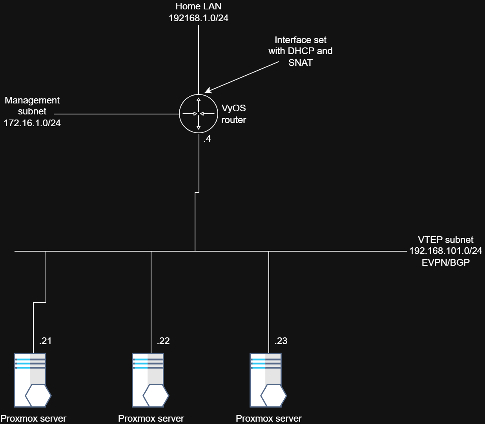

# Purpose
This repository contains the required Terraform and Ansible files to automate the creation and configuration of a VyOS router and Proxmox SDN EVPN network.
The repository does not contain the custom ISO file of VyOS, this should be generated by yourself. More information of how it's done check [here](https://lptekdev.github.io/homelab/EVPNConfigurationAutomationProxmox/).

# Variables documentation

**variables.tf**
| Name | Description  | 
|----------|-------------|
| vrf_tenant_zone_vni    | Zone VNI   |
| vrf_tenant_zone_name    | Zone name   |
| router_hostname | VyOS router hostname    |
| management_ip_address | VyOS router management IP address    |
| management_gw |  VyOS router management subnet gateway    |
| pve | Proxmox host to deploy VyOS router    |
| sdn_peers | List of IPs of the EVPN Proxmox peers + the VyOS TEP IP   |
| vm_source_id | VyOS template ID   |
| destination_storage | Storage in Proxmox to clone the router   |
| bgp_asn | BGP AS number    |
| tep_vlan_id | TEP subnet VLAN ID |
| management_vlan_id | The VLAN ID of management interface in the router |

**router-tenantA.yml**
| Name | Description  | 
|----------|-------------|
| vrf_name | Same as vrf_tenant_zone_name   |
| vrf_zone_vni | Same as vrf_tenant_zone_vni   |
| vrf_tenant_zone_vxlan | VRF VXLAN interface   |
| vrf_tenant_zone_bridge | VRF Bridge interface    |
| bgp_as_number | Same as bgp_asn    |
| ibgppeergroup | Proxmox BGP peer group    |
| proxmox_evpn_peers | Same sdn_peers , but without the VyOS TEP IP   |
| overlay_ip_address | VyOS TEP CIDR   |
| overlay_ip_address_n_mask | VyOS TEP CIDR without netmask    |
| management_gw | Same as management_gw   |

**inventory.ini**
| Name | Description  | 
|----------|-------------|
| router-tenantA | VyOS management IP address |

# Before run
There are some variables that need to be adjusted before running Terraform and Ansible playbooks:
- Ansible/hosts_vars/router_tenantA.yml: proxmox_evpn_peers -> specify the Proxmox VTEPs IPs
- Ansible/inventory.ini -> Specify the VyOS IP address in the ansible_host
- Terraform/provider.tf:
    - Proxmox endpoint
    - Username and password
- Terraform/variables.tf:
    - management_ip_address -> VyOS router IP address
    - pve -> Proxmox host to create the VM
    - sdn_peers -> Proxmox hosts VTEP IPs + VyOS VTEP IP
    - vm_source_id -> the VyOS Proxmox template ID
    - destination_storage -> Proxmox storage to clone the router

The management VLAN is 501 and VTEPs VLAN is 50. Those are harcoded in the vyos-router.tf file where the router is cloned.

# Run
In the main folder, create a python virtual environment, activate the virtual environment and and install the requirements (file requirements).

In the Terraform folder, run:
1. terraform init
2. terraform apply

In the Ansible folder, run byt the following order:
1.	ansible-playbook -i inventory.ini -e ansible_user=vyos -e ansible_password=PASSWORD router-tenantA-add-management-vrf.yaml
2.	ansible-playbook -i inventory.ini -e ansible_user=vyos -e ansible_password=PASSWORD router-tenantA-add-commands.yaml

The ansible_username and ansible_password are the VyOS router credentials that you define when you install the VyOS template. By default the username is vyos, and VyOS installation prompts for the password.